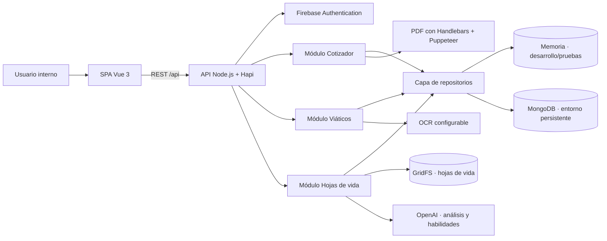
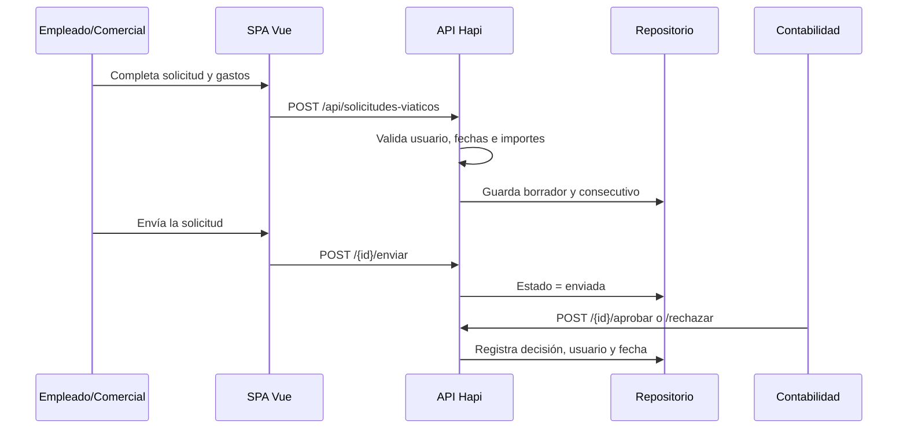

# 08 · Arquitectura implementada

> Esta página describe el código ejecutable al cierre del Sprint 3. Sustituye la arquitectura aspiracional de Sprint 0 para evitar diferencias entre documentación, demostración y repositorio.

## Vista general

En la nube, la API y la interfaz compilada corren en un solo contenedor Docker en Render, con MongoDB Atlas como base de datos ([29 · Despliegue](29-Sprint-3-Despliegue.md)).

## Decisión para el MVP

Se implementó un **monolito modular**: una sola aplicación web y una sola API, separadas internamente por dominio. Para un equipo académico y un primer MVP ofrece despliegue, depuración y pruebas simples, sin perder límites claros entre Cotizador, Viáticos y Hojas de vida. La extracción a servicios independientes queda disponible si el volumen o la operación lo justifican con evidencia.

## Capas y responsabilidades

| Capa         | Implementación                | Responsabilidad                                                           |
| ------------ | ----------------------------- | ------------------------------------------------------------------------- |
| Presentación | Vue 3, Vue Router, Pinia, CSS | Navegación, formularios, validación inmediata y estados visuales          |
| API          | Hapi                          | Rutas REST, validación de entrada, autenticación y autorización           |
| Dominio      | Servicios por módulo          | Cálculos de postes, solicitudes, OCR, análisis de hojas de vida y ranking |
| Datos        | Repositorios intercambiables  | Persistencia en memoria para pruebas o MongoDB para ejecución persistente |
| Salidas      | Puppeteer, TXT                | Cotización PDF y exportación contable                                     |

## Módulos entregados

### Cotizador de postes

- Consulta parámetros y catálogos de configuraciones.
- Calcula materiales, áreas, pesos, costos, AIU y precio final.
- Guarda una instantánea de configuración y parámetros para reproducibilidad.
- Genera consecutivo anual y cotización PDF con vigencia.
- Permite consultar el historial.

### Gestión de viáticos

- Crea solicitudes de viaje con gastos estimados y total automático.
- Maneja estados borrador, enviada, aprobada y rechazada según el rol.
- Recibe soportes JPG, PNG o PDF de máximo 10 MB.
- Extrae y permite corregir datos OCR conservando trazabilidad.
- Ofrece historial, revisión contable, indicadores y exportación TXT.

### Hojas de vida (Sprint 3)

- Registra candidatos a mano o desde su hoja de vida PDF o DOCX, con la autorización de tratamiento de datos (Ley 1581 de 2012).
- Guarda los documentos en GridFS (bucket `documentosCandidatos`); el candidato solo conserva su metadata.
- La IA (OpenAI, salida con esquema JSON estricto y `store: false`) **propone** los datos de la hoja de vida y RRHH los confirma; las correcciones quedan registradas.
- Evalúa al candidato frente a una vacante: formación, experiencia y certificaciones con reglas fijas; la IA solo valora las habilidades, con evidencia. Edad, género, estado civil, foto, origen, religión, discapacidad, salud e identificación no llegan a la IA ni al puntaje.
- La evaluación es un apoyo: no cambia la etapa del candidato ni lo descarta. Solo RRHH y administración acceden al módulo.

## Seguridad

- Firebase verifica identidad cuando se configura un proyecto real.
- El modo demostración está aislado por configuración y no debe habilitarse en producción.
- La API aplica autorización por rol y limita los registros al usuario propietario.
- Joi valida cada entrada antes de ejecutar lógica de negocio.
- Los secretos se cargan por variables de entorno y los archivos `.env` están excluidos de Git.
- Dependabot, auditoría de dependencias y CodeQL cubren vulnerabilidades conocidas y análisis de código.

## Persistencia y deuda conocida

MongoDB es la opción persistente implementada; en la nube corre en MongoDB Atlas. El repositorio en memoria permite demostración y pruebas reproducibles. Las hojas de vida ya se guardan en GridFS; los soportes de viáticos siguen como documentos codificados y conviene moverlos a un almacenamiento privado de objetos con URLs firmadas. El plan gratuito de Atlas (M0) no tiene copias automáticas ([29 · Despliegue](29-Sprint-3-Despliegue.md)).

## Flujo de una solicitud de viaje

**Anterior:** [[07 Funcionalidades]] · **Siguiente:** [[09 Stack tecnologico]]
