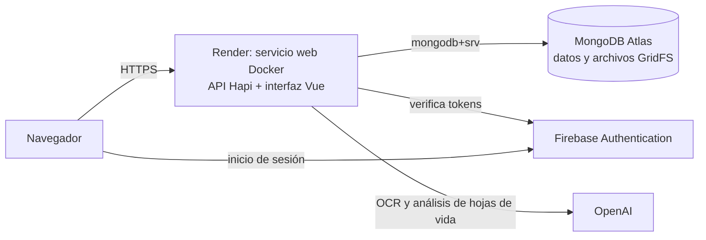

# Sprint 3 — Despliegue en la nube (HU-32)

**Aplicación:** https://galco-suite.onrender.com

**Primer despliegue:** 10 de noviembre de 2026, desde `main`. La prueba de humo (`npm run smoke:deploy`) pasó completa contra la URL pública, y `http://` redirige a `https://`.

La Suite GALCO se publica como **un solo servicio web en Render**, construido con Docker desde este repositorio. El mismo servicio entrega la API y la interfaz, y se apoya en tres servicios gestionados:



| Pieza                       | Archivo                           | Qué hace                                                                                                                                                                     |
| --------------------------- | --------------------------------- | ---------------------------------------------------------------------------------------------------------------------------------------------------------------------------- |
| Imagen                      | `Dockerfile`                      | Compila la interfaz con la configuración web de Firebase y arma la imagen de ejecución con Node 22 y Chromium (PDF de cotizaciones). Corre sin privilegios de administrador. |
| Exclusiones                 | `.dockerignore`                   | Deja fuera de la imagen los `.env`, las cuentas de servicio de Firebase, `node_modules`, pruebas y documentación.                                                            |
| Infraestructura como código | `render.yaml`                     | Blueprint de Render: servicio, región, rama, health check y variables de entorno. Los secretos van marcados `sync: false`: se escriben en el panel, nunca en el repositorio. |
| Verificación                | `backend/scripts/smoke-deploy.js` | Prueba de humo después de cada despliegue.                                                                                                                                   |

## 1. MongoDB Atlas

1. Crear un clúster **M0 (gratuito)**, de preferencia en AWS `us-east-1` (cerca de la región de Render).
2. **Database Access → Add New Database User**: usuario `galco-app`, contraseña generada y larga, rol **Read and write to any database** (o, mejor, un rol personalizado `readWrite` sobre la base `galco_suite`).
3. **Network Access → Add IP Address → `0.0.0.0/0`**. El plan gratuito de Render no tiene IP fija, así que la protección depende del usuario y la contraseña: no reutilizar esa contraseña en ningún otro lado.
4. **Connect → Drivers** y copiar la cadena `mongodb+srv://galco-app:<contraseña>@<clúster>.mongodb.net/?retryWrites=true&w=majority`. Esa es `MONGO_URI`. El nombre de la base va aparte, en `MONGO_DB=galco_suite`.

La aplicación crea sus colecciones e índices al arrancar. Los archivos de hojas de vida van a GridFS (`documentosCandidatos.*`) dentro de la misma base.

## 2. Firebase Authentication

1. **Authentication → Settings → Authorized domains → Add domain**: agregar el dominio que asigne Render (por ejemplo `galco-suite.onrender.com`). Sin esto, el inicio de sesión y la recuperación de contraseña fallan en la nube.
2. **Cuenta de servicio** (servidor): en Configuración del proyecto → Cuentas de servicio → Generar nueva clave privada. El contenido completo del JSON, en **una sola línea**, es `FIREBASE_CREDENTIALS_JSON`. Nunca se sube al repositorio.
3. **Configuración web** (interfaz): Configuración del proyecto → Tus apps → la app web. Sus valores van en las variables `VITE_FIREBASE_*`. No son secretos: viajan en el JavaScript que recibe el navegador.

## 3. Render

1. **New → Blueprint**, conectar el repositorio `jdj40211/GalcoProyecto2` y elegir la rama: `main` cuando estén fusionados los PR del Sprint 3; mientras tanto, `feature/hu-32-despliegue`, que ya los contiene. Render lee `render.yaml` de esa rama y despliega desde ella.
2. Render pide los valores marcados `sync: false`:

| Variable                                                                                                                    | Valor                                                                                            |
| --------------------------------------------------------------------------------------------------------------------------- | ------------------------------------------------------------------------------------------------ |
| `MONGO_URI`                                                                                                                 | Cadena de conexión de Atlas (paso 1.4)                                                           |
| `FIREBASE_CREDENTIALS_JSON`                                                                                                 | JSON de la cuenta de servicio en una línea (paso 2.2)                                            |
| `FIREBASE_PROJECT_ID`                                                                                                       | Id del proyecto de Firebase                                                                      |
| `FIREBASE_EMAIL_DOMAIN` y `VITE_FIREBASE_EMAIL_DOMAIN`                                                                      | Dominio con el que se completa el usuario corto (`jdiaz` → `jdiaz@<dominio>`); el mismo en ambas |
| `VITE_FIREBASE_API_KEY`, `..._AUTH_DOMAIN`, `..._PROJECT_ID`, `..._STORAGE_BUCKET`, `..._MESSAGING_SENDER_ID`, `..._APP_ID` | Configuración web de Firebase (paso 2.3)                                                         |
| `OPENAI_API_KEY`                                                                                                            | Clave de OpenAI                                                                                  |

3. **Apply**. Render construye la imagen (unos 5 minutos la primera vez) y solo publica la versión cuando `/api/health` responde.

Las variables `VITE_*` se usan **al compilar** la interfaz. Si se cambian, hay que volver a desplegar (**Manual Deploy → Deploy latest commit**). Si faltan, la compilación se detiene con el mensaje `Faltan VITE_FIREBASE_API_KEY y VITE_FIREBASE_PROJECT_ID` en lugar de publicar una interfaz que no puede iniciar sesión.

## 4. Verificación del despliegue

```bash
node backend/scripts/smoke-deploy.js https://<servicio>.onrender.com
```

Comprueba que la API responda usando MongoDB, que la interfaz y sus archivos carguen, que los datos exijan sesión, que la API inexistente responda 404 y que no se publiquen archivos fuera de la interfaz. Sale con código distinto de 0 si algo falla.

Después, la verificación manual con cada rol: iniciar sesión, crear y descargar el PDF de una cotización, registrar un viático con OCR, registrar un candidato, adjuntar su hoja de vida, analizarla y evaluarla contra una vacante.

## 5. Usuarios

Los usuarios viven en Firebase, así que son los mismos en local y en la nube. Se crean desde un equipo con la cuenta de servicio configurada en `backend/.env`:

```bash
cd backend
node scripts/usuarios.js crear <usuario> "<Nombre completo>" <comercial|contabilidad|rrhh|admin>
```

El script imprime un enlace para que la persona defina su contraseña. Con un administrador creado, los demás usuarios se pueden crear desde la aplicación (**Usuarios**).

## 6. Actualizaciones y reversión

- **Despliegue automático:** cada push a la rama del Blueprint construye y publica una versión nueva. Si el health check falla, Render mantiene la versión anterior en línea.
- **Revertir:** en Render, **Events → Rollback** sobre un despliegue anterior.
- **Después de cada despliegue:** correr la prueba de humo (sección 4).

## 7. Seguridad

- Los secretos solo existen en el panel de Render. `.dockerignore` excluye los `.env` y las cuentas de servicio, así que tampoco entran a la imagen.
- `NODE_ENV=production` con `AUTH_BYPASS=true` detiene el arranque: el modo demo no puede quedar activo en la nube.
- El contenedor corre con el usuario `node`, sin privilegios de administrador.
- HTTPS lo da Render. OpenAI recibe las solicitudes con `store: false`, sin conservar el contenido.
- Atlas: usuario dedicado con permisos solo de lectura y escritura y contraseña única (la red queda abierta por la limitación del plan gratuito).

## 8. Límites del plan gratuito

| Límite                                                 | Efecto                                                                                                  | Qué hacer                                                                          |
| ------------------------------------------------------ | ------------------------------------------------------------------------------------------------------- | ---------------------------------------------------------------------------------- |
| Render se suspende tras 15 minutos sin tráfico         | La primera visita tarda cerca de un minuto                                                              | Abrir la aplicación unos minutos antes de una demostración, o usar el plan Starter |
| Render: 512 MB de memoria                              | Suficiente en las pruebas (el contenedor usa ~50 MB en reposo; Chromium se abre solo al generar un PDF) | Si aparece "out of memory", pasar a Starter                                        |
| Atlas M0: 512 MB y sin copias de seguridad automáticas | Los archivos de hojas de vida ocupan espacio                                                            | Exportar con `mongodump` antes de cada entrega                                     |

## 9. Solución de problemas

| Síntoma                                                  | Causa probable                                               | Solución                                       |
| -------------------------------------------------------- | ------------------------------------------------------------ | ---------------------------------------------- |
| La compilación falla con "Faltan VITE_FIREBASE_…"        | No se configuraron las variables `VITE_FIREBASE_*`           | Agregarlas y volver a desplegar                |
| El servicio no arranca: `MongoServerSelectionError`      | `MONGO_URI` incorrecta o IP no permitida en Atlas            | Revisar la cadena y Network Access             |
| El servicio no arranca: error de `[firebase]`            | `FIREBASE_CREDENTIALS_JSON` incompleto o con saltos de línea | Pegar el JSON completo en una línea            |
| `auth/unauthorized-domain` al iniciar sesión             | Falta el dominio de Render en Firebase                       | Paso 2.1                                       |
| El inicio de sesión dice "no tiene un rol asignado"      | El usuario de Firebase no tiene rol                          | `node scripts/usuarios.js rol <usuario> <rol>` |
| El OCR o el análisis responden "OpenAI rechazó la clave" | `OPENAI_API_KEY` inválida o sin saldo                        | Revisar la clave en el panel de OpenAI         |

## Verificación realizada antes del primer despliegue

La imagen se construyó y se ejecutó en local en modo producción (Firebase real, MongoDB, `AUTH_BYPASS=false`), con el mismo `Dockerfile`:

- Sin la configuración web de Firebase, la compilación se detiene con el mensaje esperado; con ella compila, y el registro de compilación no muestra sus valores.
- La prueba de humo pasó completa contra el contenedor.
- Chromium generó el PDF de una cotización dentro del contenedor (70 KB en 2,6 s); el contenedor usaba unos 47 MB de memoria en reposo.
