# Manual de usuario — Suite GALCO

Guía para las personas de GALCO que usan la Suite: **Comercial**, **Contabilidad**, **Recursos Humanos** y **Administración**. Cada rol tiene su propia sección; empiece por "Para todos".

- **Dirección:** https://galco-suite.onrender.com
- **Navegador:** Chrome, Edge o Firefox actualizados, en computador o celular. No hay que instalar nada.
- **Primera carga del día:** si nadie ha usado la aplicación en los últimos 15 minutos, tarda cerca de un minuto en abrir. Es normal; espere sin recargar.

> Las imágenes de este manual se tomaron con datos ficticios en el entorno de pruebas. Lo que vea en su pantalla puede tener otros nombres y cifras.

## Contenido

1. [Para todos: entrar, moverse y salir](#1-para-todos-entrar-moverse-y-salir)
2. [Comercial](#2-comercial)
3. [Contabilidad](#3-contabilidad)
4. [Recursos Humanos](#4-recursos-humanos)
5. [Administración](#5-administración)
6. [Preguntas frecuentes y problemas comunes](#6-preguntas-frecuentes-y-problemas-comunes)
7. [Glosario](#7-glosario)

## Qué ve cada rol

| Rol              | Al entrar llega a        | Menú                                                                                                                     |
| ---------------- | ------------------------ | ------------------------------------------------------------------------------------------------------------------------ |
| Comercial        | Subir comprobante        | **Viáticos:** Solicitudes de viaje, Notificaciones, Legalizar viaje, Subir comprobante, Validar datos, Historial. **Cotizador:** Catálogo de postes, Nueva cotización, Historial de cotizaciones, Indicadores |
| Contabilidad     | Panel de contabilidad    | **Viáticos:** Solicitudes de viaje, Notificaciones, Panel de contabilidad, Dashboard. **Cotizador:** las mismas cuatro opciones |
| Recursos Humanos | Candidatos               | **Hojas de vida:** Candidatos, Vacantes                                                                                  |
| Administración   | Usuarios                 | **Administración:** Usuarios. **Hojas de vida:** Candidatos, Vacantes                                                     |

Cada persona solo ve las opciones de su rol. Si abre una dirección de otro módulo, la aplicación lo devuelve a su inicio.

---

## 1. Para todos: entrar, moverse y salir

### Iniciar sesión

1. Abra https://galco-suite.onrender.com.
2. Escriba su **usuario** (la parte antes de la @ de su correo institucional; también sirve el correo completo) y su **contraseña**.
3. Pulse **Iniciar sesión**. El ojo junto a la contraseña la muestra u oculta.

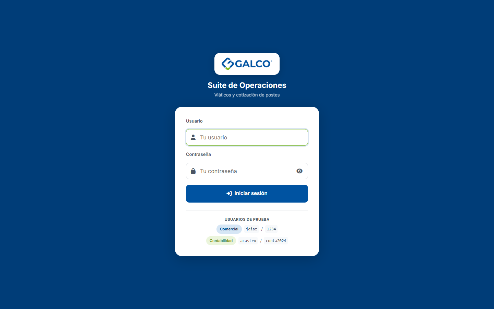

### Olvidé mi contraseña

1. En la pantalla de inicio pulse **¿Olvidaste tu contraseña?**.
2. Escriba su usuario o correo y confirme.
3. Revise su correo: llega un enlace para crear una contraseña nueva. Por seguridad, el mensaje en pantalla es el mismo exista o no la cuenta.

### Moverse por la aplicación

- El **menú lateral** (izquierda) agrupa las opciones por módulo. En el celular se recoge para dejar espacio.
- Arriba a la derecha están su rol y sus iniciales.
- Los mensajes verdes confirman una acción; los rojos explican un error y qué hacer.

### Cerrar sesión

Pulse **Cerrar sesión** al final del menú. Por seguridad, la sesión **se cierra sola después de 30 minutos sin actividad**; vuelva a iniciar sesión.

---

## 2. Comercial

### 2.1 Consultar el catálogo de postes

1. Menú **Catálogo de postes**.
2. Escriba en el buscador un código, nombre o tipo (no importan mayúsculas).
3. **Ver componentes y especificaciones** muestra el detalle; **Usar configuración** la lleva al cotizador.

Las configuraciones **Inactivas** se ven, pero no se pueden cotizar.

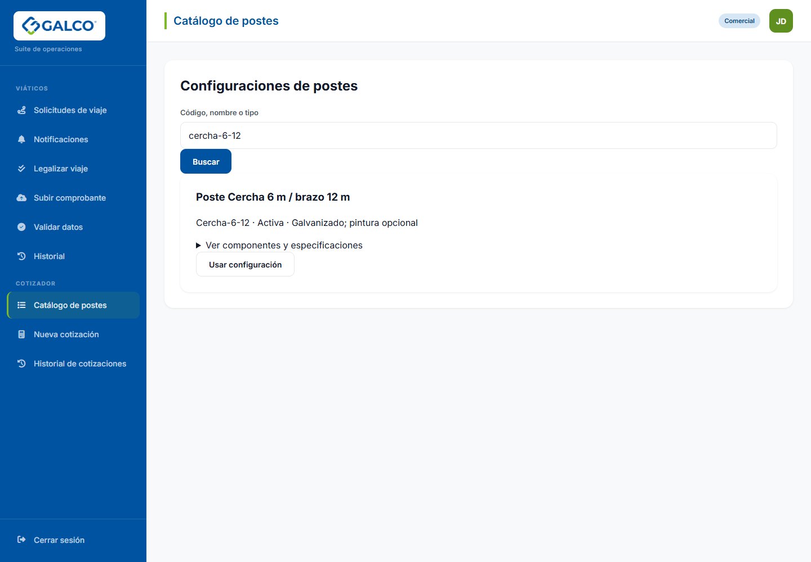

### 2.2 Crear una cotización

1. Menú **Nueva cotización**.
2. Elija **Tipo de poste**, **Altura (m)**, **Brazo / Ancho (m)**, **Cantidad** y **Pintura**.
3. Pulse **Calcular**: a la derecha aparecen pesos, áreas, costos y precio final.
4. Complete **Cliente**, **Vendedor**, **Vigencia hasta** (no puede ser una fecha pasada) y, si quiere, **Observaciones**.
5. Pulse **Guardar cotización**. Queda con un consecutivo y en estado **Borrador**.
6. Pulse **Descargar PDF** para obtener el documento que se entrega al cliente.

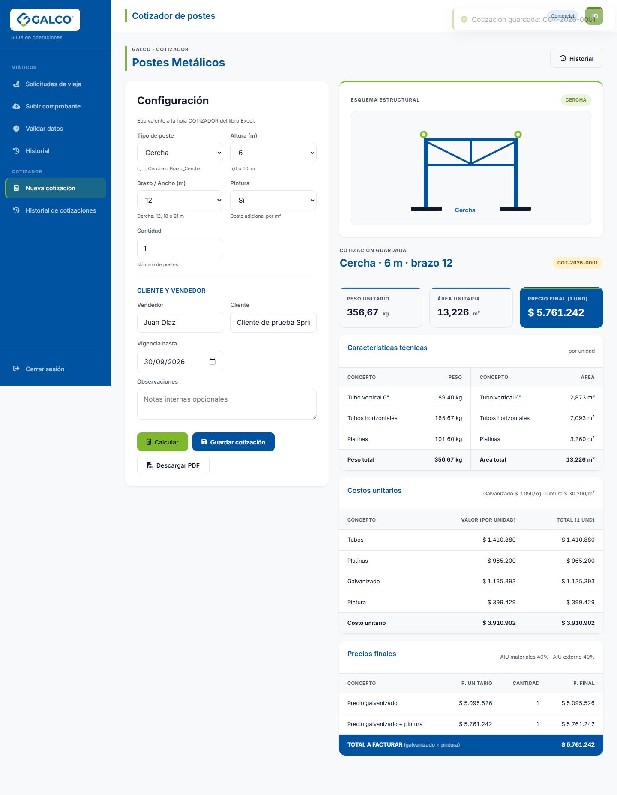

> **Cómo se entrega la cotización al cliente:** descargue el PDF y envíelo por el medio habitual. **La Suite no envía correos.** Aunque en el historial aparece el botón "Enviar por correo", el envío no está habilitado y mostrará un error.
>
> **Revise el PDF antes de enviarlo:** hay un error conocido (#63) por el que la nota de AIU puede salir sin cifras y la línea "Versión:" vacía.

### 2.3 Historial, variantes y estados

Menú **Historial de cotizaciones** (para Comercial la pantalla se titula **Mis cotizaciones**: solo ve las suyas).

- Filtre por cliente o estado.
- **PDF:** descarga el PDF de esa cotización.
- **Duplicar variante:** crea una copia independiente para ofrecer una alternativa (por ejemplo, sin pintura). El original no cambia.
- **Editar:** solo en cotizaciones propias en **Borrador**. Al guardar, la variante se recalcula con los precios vigentes.

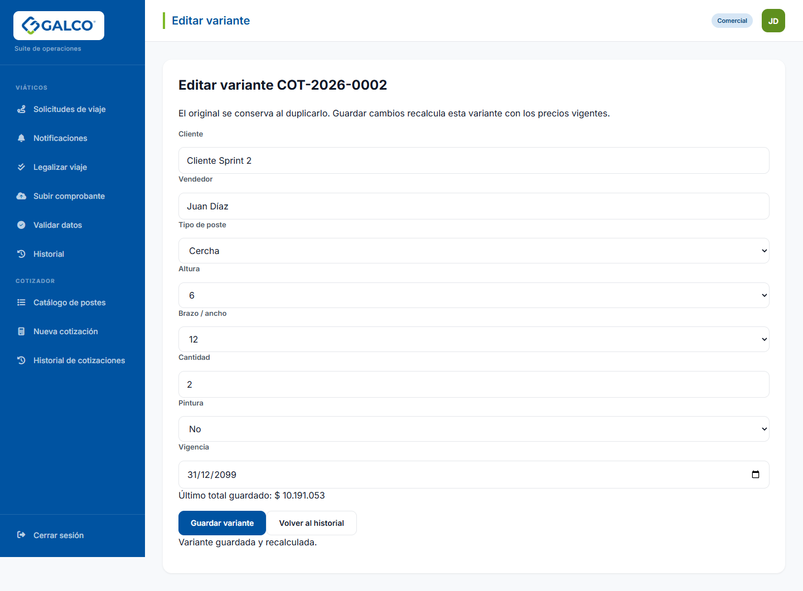

Estados: **Borrador → Aprobada / Rechazada / Anulada**. Contabilidad es quien cambia el estado (ver 3.4). Una vez aprobada, rechazada o anulada, la cotización ya no cambia.

### 2.4 Indicadores de cotizaciones

Menú **Indicadores**. Elija **Desde** y **Hasta** para ver: valor cotizado, valor aprobado, tasa de aprobación, tiempos de respuesta y de decisión, cotizaciones por estado y valor cotizado por mes. Un comercial ve sus propios indicadores.

### 2.5 Solicitar un viaje (viáticos)

1. Menú **Solicitudes de viaje**.
2. En **Nueva solicitud de viáticos** complete **Destino**, **Fecha inicial**, **Fecha final**, **Motivo del viaje** y **Centro de costo**.
3. En **Gastos estimados** pulse **Agregar gasto** por cada concepto (categoría, descripción y valor). El **Total solicitado** se suma solo.
4. Pulse **Guardar borrador**.
5. En **Mis solicitudes**, use el ícono **Enviar a aprobación**. Desde ese momento ya no se puede editar.

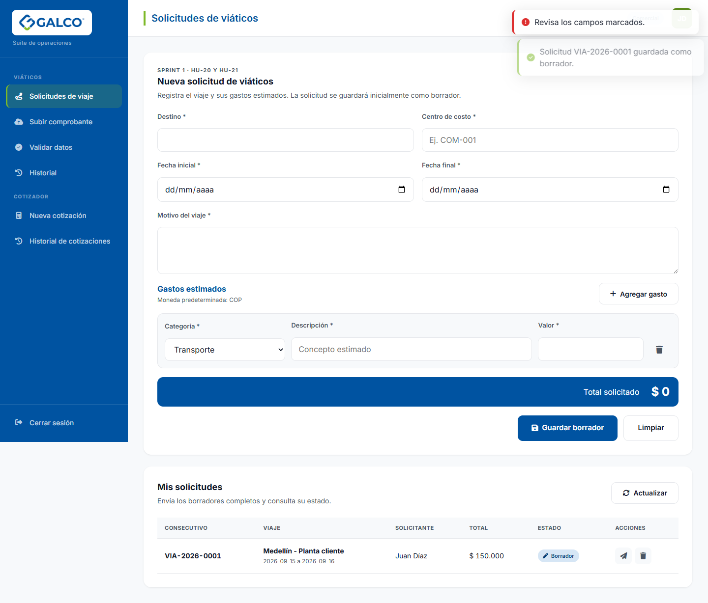

### 2.6 Registrar un comprobante con lectura automática

1. Menú **Subir comprobante**.
2. Arrastre la foto o PDF del recibo, o pulse **Seleccionar archivo**. Formatos: JPG, JPEG, PNG y PDF de hasta 10 MB.
3. La aplicación endereza, recorta y mejora el contraste. Si algo quedó mal, abra **Ajustar la imagen manualmente** (rotación, recorte de bordes y contraste) y pulse **Ver preparación**. El archivo original siempre se conserva.
4. Pulse **Procesar con IA / OCR**.
5. En **Validar datos extraídos**, **revise cada campo**: los campos en amarillo quedaron pendientes. Corrija lo que haga falta.
6. Si el gasto es de un viaje aprobado, elíjalo en **Solicitud de viaje aprobada**; si no, déjelo como **Gasto independiente**.
7. Pulse **Confirmar información**. El comprobante queda **Pendiente revisión** para Contabilidad.

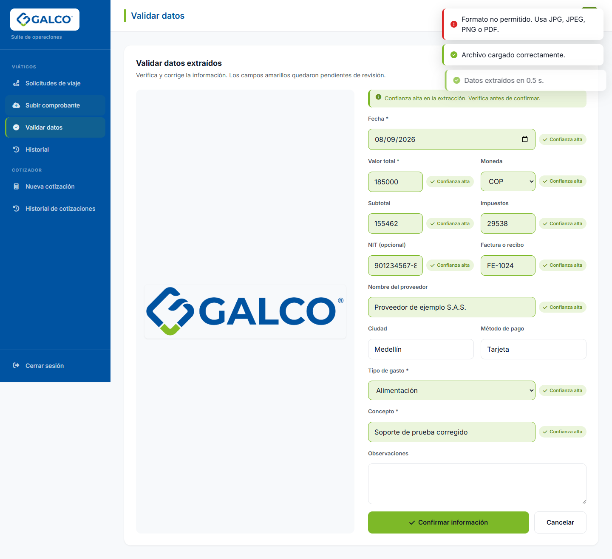

La lectura automática **propone** los datos; usted es responsable de confirmarlos.

### 2.7 Historial de viáticos y notificaciones

- **Historial:** consulta, filtra y descarga sus comprobantes; **Descargar TXT consolidado** exporta los aprobados. **Eliminar** borra un comprobante después de pedir confirmación; no se puede deshacer.
- **Notificaciones:** avisos cuando Contabilidad aprueba o rechaza una solicitud, con el motivo del rechazo. Use **Marcar como leída**.

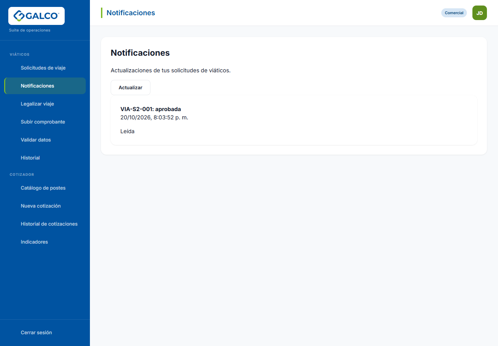

### 2.8 Legalizar un viaje

1. Menú **Legalizar viaje**.
2. Elija la **Solicitud aprobada**.
3. Marque los **Soportes aprobados por Contabilidad** de ese viaje.
4. Escriba el **Anticipo recibido (COP)**.
5. La aplicación compara el anticipo con el gasto real y muestra si hay un saldo **por reintegrar** a la empresa o **por reembolsar al empleado**.
6. Pulse **Confirmar legalización**. Un viaje legalizado no se puede legalizar de nuevo ni cambiar sus soportes.

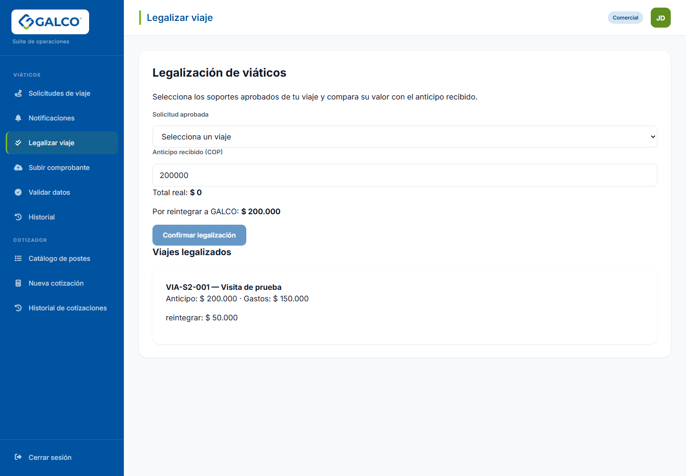

---

## 3. Contabilidad

### 3.1 Aprobar o rechazar solicitudes de viaje

1. Menú **Solicitudes de viaje** (para Contabilidad la pantalla se titula **Solicitudes por aprobar**).
2. Revise destino, fechas, motivo y total.
3. Use **Aprobar solicitud** o **Rechazar solicitud**. Al rechazar, escriba un motivo claro: el solicitante lo verá en sus notificaciones.

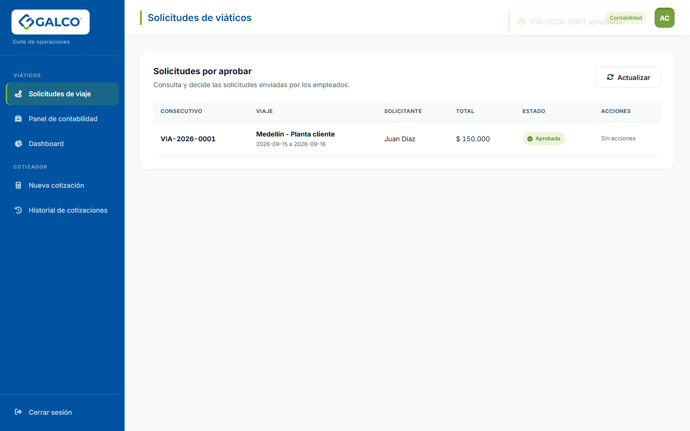

### 3.2 Revisar comprobantes (Panel de contabilidad)

1. Menú **Panel de contabilidad**. Arriba ve los totales: pendientes de revisión, aprobados, rechazados, incompletos y exportados.
2. En cada comprobante use **Ver detalle**, **Aprobar** o **Rechazar** (con motivo).
3. **Exportar aprobados a TXT** genera el archivo para el sistema contable.

### 3.3 Dashboard

Menú **Dashboard**: total gastado, aprobado y pendiente, promedio por viático, gasto por tipo y viáticos por estado.

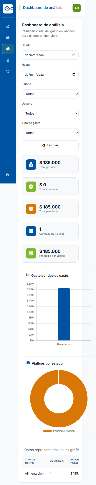

### 3.4 Cotizaciones

Contabilidad usa el mismo cotizador que Comercial (secciones 2.1 a 2.4) y además:

- En **Historial** ve las cotizaciones de **todos** los comerciales.
- Puede cambiar el estado con **Cambiar a…** (Aprobada, Rechazada o Anulada). La aplicación pide confirmación porque estos estados no tienen vuelta atrás.
- En **Catálogo de postes** puede **Activar** o **Desactivar** configuraciones.

---

## 4. Recursos Humanos

El módulo de Hojas de vida ayuda a registrar candidatos sin digitar sus datos y a compararlos contra los mismos criterios.

### Reglas que conviene conocer

- **La IA propone; usted decide.** Ningún dato queda guardado hasta que usted lo revisa y pulsa **Confirmar datos**.
- **El puntaje es un apoyo.** No descarta a nadie ni cambia la etapa del candidato.
- **La IA no usa ni recibe** edad, género, estado civil, foto, origen, religión, discapacidad, salud ni número de identificación. Para evaluar habilidades solo recibe el perfil profesional, sin nombre ni datos de contacto.
- **Autorización de datos (Ley 1581 de 2012):** sin ella no se envía nada a la IA. Marque la casilla solo si el candidato efectivamente autorizó el tratamiento de sus datos.
- El proveedor de IA (OpenAI) recibe las hojas de vida con la opción de no conservarlas.

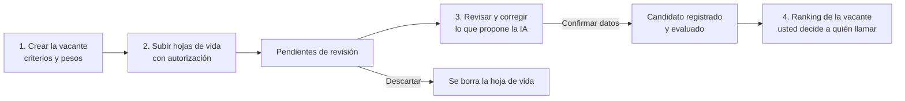

### 4.1 Crear una vacante

1. Menú **Vacantes**.
2. Complete **Cargo**, **Formación mínima** (de Bachiller a Doctorado) y **Años mínimos de experiencia**. Opcionales: área, ciudad, **certificaciones obligatorias**, **certificaciones deseables** y **habilidades requeridas** (separadas por comas).
3. En **Peso de cada criterio** reparta 100 puntos entre Formación, Experiencia, Certificaciones y Habilidades. El total se ve en vivo; si no suma 100, la aplicación le dice cuántos puntos faltan o sobran.
4. Pulse **Crear vacante**.

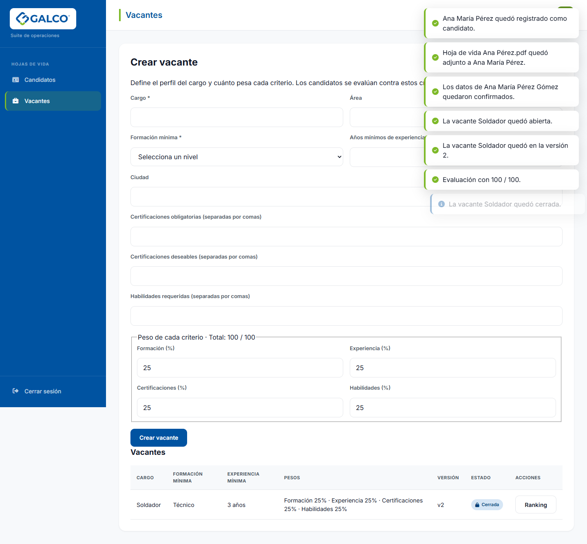

En el listado:

- **Editar** guarda una versión nueva (v2, v3…). Las evaluaciones ya hechas conservan la versión con la que se calcularon.
- **Cerrar** deja la vacante en consulta: ya no admite evaluaciones ni cambios.
- **Ranking** abre la clasificación de candidatos de esa vacante.

### 4.2 Registrar candidatos desde sus hojas de vida (forma recomendada)

1. Menú **Candidatos**, sección **Registrar candidatos**.
2. Elija la **Vacante** (solo aparecen las abiertas).
3. Seleccione una o varias **hojas de vida PDF o DOCX** (máximo 10 MB cada una).
4. Marque **Los candidatos autorizaron el tratamiento de sus datos personales según la Ley 1581 de 2012**.
5. Pulse **Analizar hojas de vida**. Verá el avance de cada archivo. Cada análisis puede tardar hasta unos 45 segundos.
6. Las hojas de vida analizadas aparecen en **Pendientes de revisión**, con el nombre que propuso la IA.

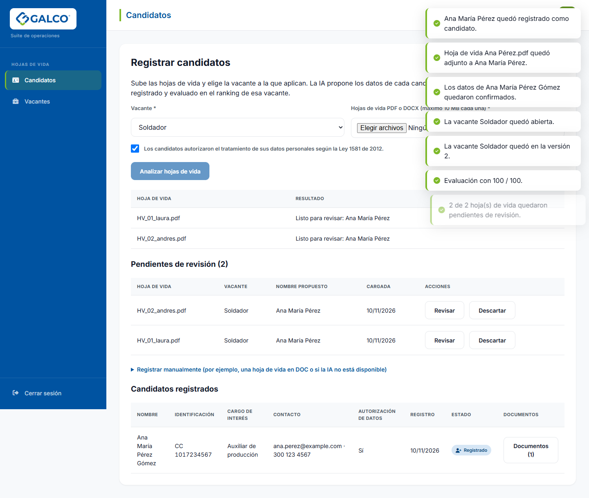

Si un archivo falla (por ejemplo, la IA no responde), la tabla lo indica y **no queda nada a medias**; los demás archivos siguen.

### 4.3 Revisar y confirmar los datos propuestos

1. En **Pendientes de revisión** pulse **Revisar**.
2. A la izquierda verá la hoja de vida; a la derecha, los datos que propuso la IA con una etiqueta de **confianza** (alta, media) o **Pendiente** en amarillo cuando falta o es dudoso.
3. Compare con el documento y **corrija** lo necesario: nombre, correo, teléfono, ciudad, formación, experiencia (fechas desde/hasta), certificaciones (con vencimiento), habilidades e idiomas. Puede agregar o quitar filas.
4. La **identificación es opcional** en este flujo; si la escribe, no puede repetirse.
5. Pulse **Confirmar datos**. El candidato queda **Registrado** y se evalúa automáticamente contra la vacante; el aviso muestra su puntaje.

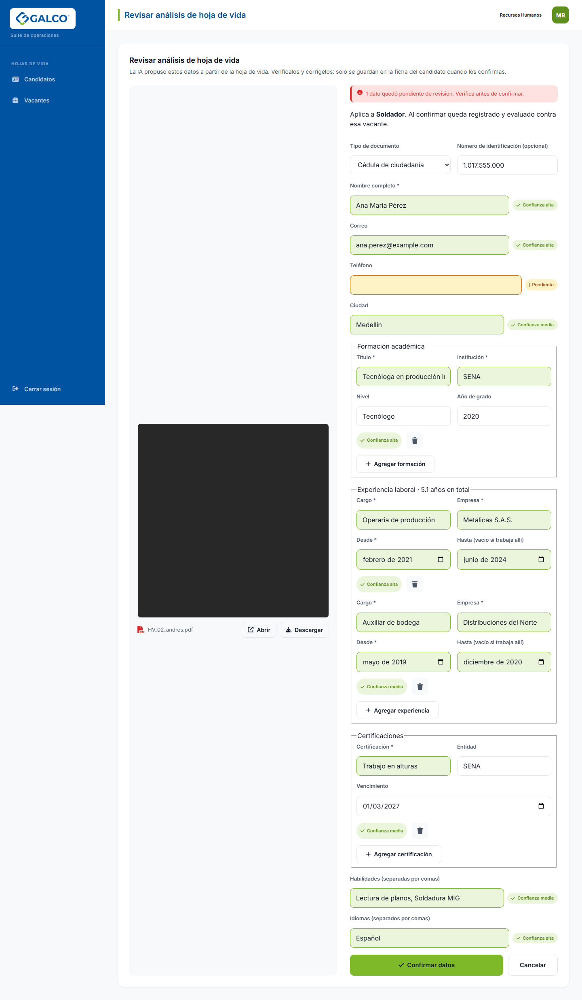

**Descartar:** si la hoja de vida no corresponde, pulse **Descartar** en la lista de pendientes. Se borran la hoja de vida y su análisis; no se puede deshacer. Un candidato ya registrado no se borra por esta vía.

Si la vacante se cerró mientras revisaba, el candidato queda registrado **sin evaluación** y la aplicación lo avisa.

### 4.4 Registro manual (alternativa)

Úselo cuando la hoja de vida está en formato DOC, cuando no hay autorización para usar la IA o si la IA no está disponible.

1. Despliegue **Registrar manualmente (por ejemplo, una hoja de vida en DOC o si la IA no está disponible)**.
2. Obligatorios: **Número de identificación**, **Nombre completo**, **Cargo de interés** y correo **o** teléfono.
3. Agregue formación, experiencia y certificaciones si las tiene.
4. Marque la autorización de datos si el candidato la dio.
5. Pulse **Registrar candidato**.

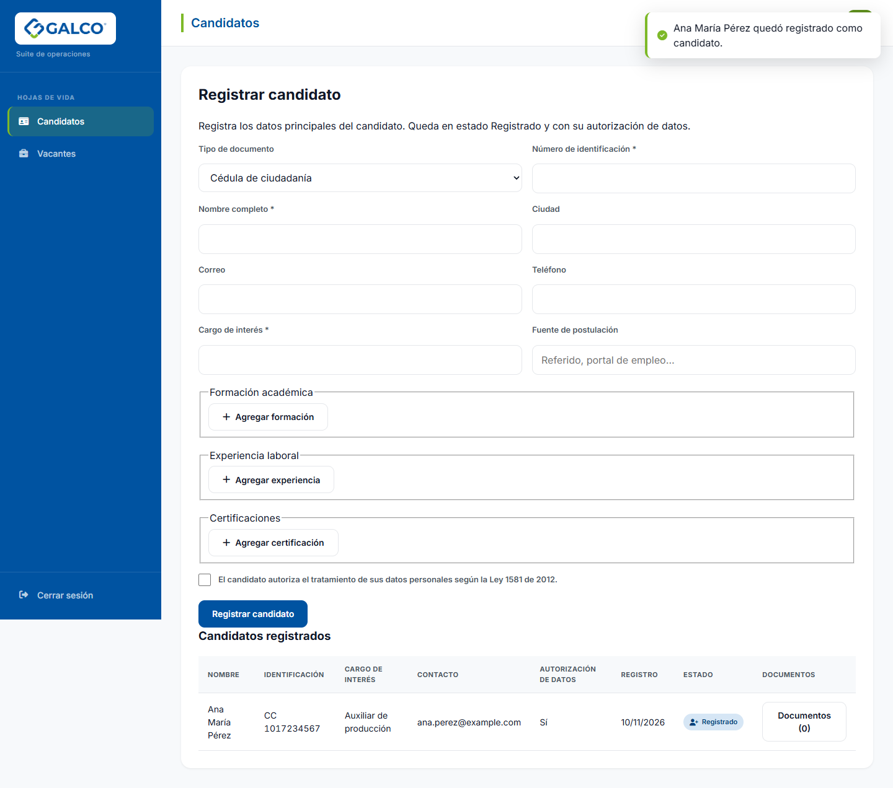

La aplicación no permite repetir una identificación (aunque se escriba con o sin puntos) ni un correo.

### 4.5 Documentos del candidato y análisis de un candidato ya registrado

1. En **Candidatos registrados**, pulse **Documentos (n)** en la fila del candidato.
2. **Descargar** baja el archivo original, sin cambios.
3. Para agregar un documento elija **Tipo de documento**, seleccione un archivo PDF, DOC o DOCX de hasta 10 MB y pulse **Adjuntar documento**.
4. **Analizar con IA** (solo PDF o DOCX) abre la misma revisión del punto 4.3. Está deshabilitado si el candidato no autorizó el tratamiento de datos.

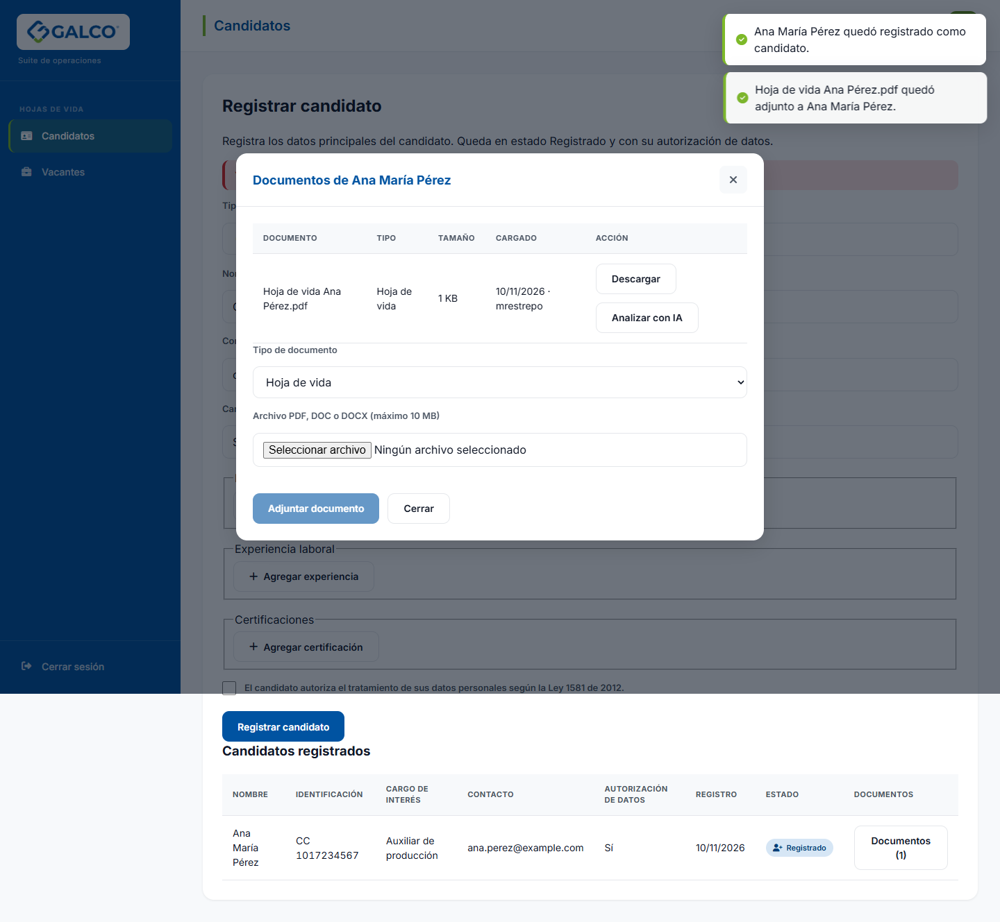

### 4.6 Ranking y evaluación

1. En **Vacantes**, pulse **Ranking** en la vacante.
2. Para evaluar a un candidato registrado, elíjalo y pulse **Evaluar**. (Los registrados desde la hoja de vida ya llegan evaluados.)
3. La tabla ordena de mayor a menor puntaje (0 a 100). Marque **Solo quienes los cumplen** para ver solo a quienes cumplen los requisitos obligatorios.
4. **Ver detalle** muestra, por criterio, el peso, el cumplimiento, el aporte al puntaje y el detalle; la evidencia de cada habilidad y una justificación. Los **requisitos obligatorios no cumplidos** aparecen en rojo aunque el puntaje sea alto.
5. **Volver a evaluar** crea una evaluación nueva (por ejemplo, después de editar la vacante) y conserva la anterior.

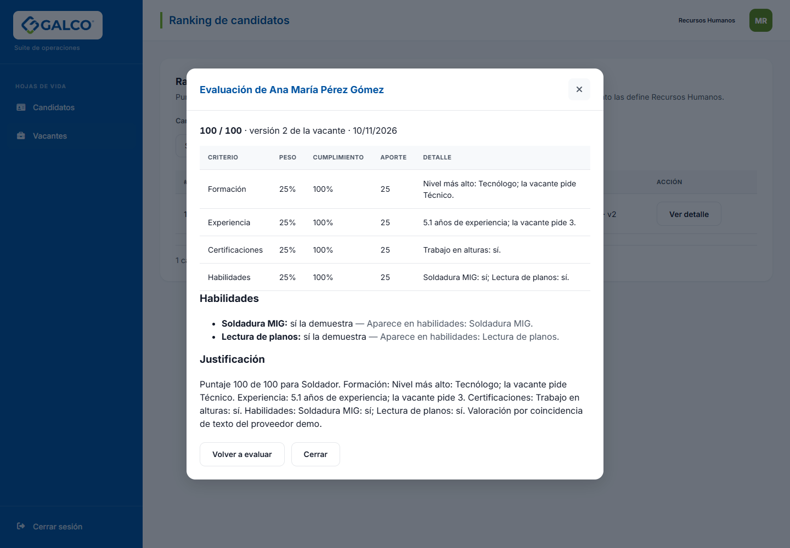

Cómo se calcula el puntaje: formación, experiencia y certificaciones se calculan con reglas fijas (una certificación vencida no cuenta); la IA solo valora si el perfil demuestra cada habilidad pedida (sí, parcial o no), citando la evidencia. Si la IA no responde, el puntaje se calcula con los demás criterios y "Habilidades" queda pendiente con un aviso.

**El ranking ayuda a decidir a quién revisar primero; la decisión de avanzar o no con un candidato es suya.**

---

## 5. Administración

### 5.1 Crear y gestionar cuentas

1. Menú **Usuarios**.
2. Complete **Nombre**, **Correo**, **Rol** (Comercial / solicitante, Contabilidad / aprobador o Recursos Humanos) y **Contraseña inicial** (mínimo 12 caracteres).
3. Pulse **Crear usuario**. La persona solo tendrá acceso al módulo de su rol.
4. En **Usuarios registrados** use **Desactivar** para retirar el acceso de inmediato o **Activar** para devolverlo. No puede desactivar su propia cuenta.

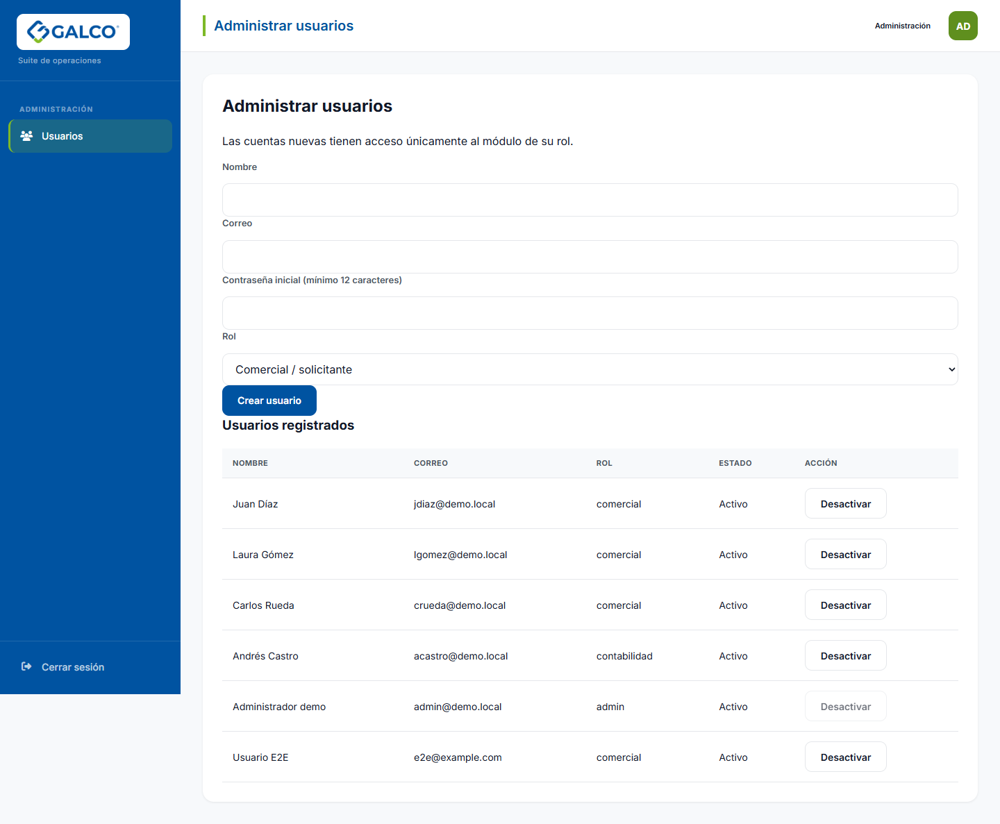

La primera cuenta de administración la crea el equipo técnico con el script de usuarios ([29 · Despliegue](29-Sprint-3-Despliegue.md), sección 5).

### 5.2 Hojas de vida

Administración tiene acceso completo a **Candidatos** y **Vacantes**, con las mismas funciones de la sección 4.

---

## 6. Preguntas frecuentes y problemas comunes

| Situación                                                          | Qué hacer                                                                                                                                 |
| ------------------------------------------------------------------ | ----------------------------------------------------------------------------------------------------------------------------------------- |
| La aplicación tarda en abrir                                       | Espere cerca de un minuto: el servicio se estaba "despertando" tras 15 minutos sin uso                                                    |
| "No tiene un rol asignado" al iniciar sesión                       | Pida a Administración que le asigne un rol                                                                                                |
| Me sacó de la aplicación                                           | Pasaron 30 minutos sin actividad. Inicie sesión de nuevo                                                                                  |
| "Enviar por correo" muestra un error                               | El envío por correo no está habilitado. Descargue el PDF y envíelo por su cuenta                                                          |
| El PDF de la cotización tiene la nota de AIU sin cifras            | Error conocido (#63) en corrección. Informe a Contabilidad antes de enviar                                                                |
| "Analizar con IA" está deshabilitado                               | El candidato no tiene registrada la autorización de datos, o el archivo es DOC. Use el registro manual                                     |
| La hoja de vida no se pudo analizar                                | Revise que sea PDF o DOCX legible de hasta 10 MB. Si la IA no responde, inténtelo más tarde o regístrelo manualmente                     |
| No aparece la vacante al subir hojas de vida                       | Solo se listan vacantes **abiertas**. Revise en Vacantes si está cerrada                                                                  |
| "El candidato ya existe"                                           | Ya hay un candidato con esa identificación o ese correo. Búsquelo en Candidatos registrados                                               |
| Los pesos de la vacante no dejan guardar                           | Deben sumar exactamente 100; el mensaje indica cuántos puntos faltan o sobran                                                             |
| Un comprobante no se reconoce bien                                 | Use **Ajustar la imagen manualmente** y vuelva a procesar; siempre puede corregir los campos a mano                                       |

Soporte: **Pendiente del equipo:** indicar a quién escribir dentro de GALCO o del equipo del proyecto (nombre del cargo y canal), sin publicar correos personales.

## 7. Glosario

| Término                  | Significado                                                                                     |
| ------------------------ | ----------------------------------------------------------------------------------------------- |
| AIU                      | Administración, imprevistos y utilidad: porcentajes que se suman al costo para el precio final  |
| Borrador                 | Registro guardado que aún se puede editar                                                       |
| Variante                 | Copia independiente de una cotización para ofrecer una alternativa                              |
| OCR                      | Lectura automática del texto de una imagen o PDF                                                |
| Legalizar                | Comparar el anticipo de un viaje con los gastos soportados y cerrar el viaje                    |
| Pendiente de revisión    | Candidato cuya hoja de vida ya analizó la IA, pero cuyos datos RRHH aún no confirma             |
| Confianza                | Qué tan seguro está el sistema de un dato que propuso: alta, media o pendiente                  |
| Requisito obligatorio    | Condición de la vacante (formación, experiencia o certificación obligatoria) que se marca en rojo si no se cumple |
| Ranking                  | Lista de candidatos de una vacante ordenada por puntaje                                         |

---

> **Pendiente del equipo:** (1) el documento maestro pide una "demostración interactiva del manual" en la sustentación: preparar el recorrido (ver [37](37-Sprint-3-Sustentacion.md)). (2) Si se quiere un video, grabarlo sobre la URL desplegada con datos ficticios y enlazarlo aquí.
